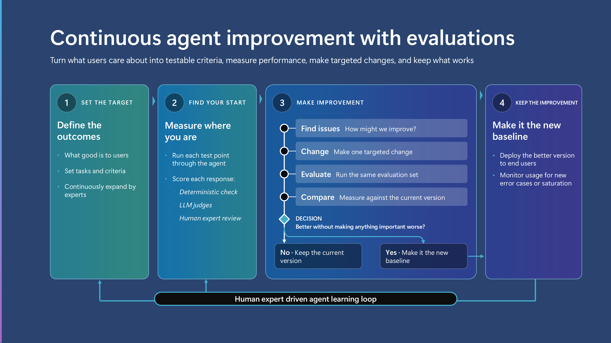

# Continuous System Improvement with Evaluations: Wharf

**Audience:** Technical Leadership Team (TLT): Technical Fellows, CVPs,
Distinguished Engineers, Partner Engineers, and VPs of Engineering.

**Framing:** The slide above was presented by a CVP on the TLT at Microsoft
Ignite the week before this document was started, according to the context
provided with the slide.

**Started:** November 25, 2026. This is a living record of targeted improvements,
the domain knowledge that motivated them, and the evidence that supports them.

The slide uses "agent"; the method is broader. Wharf is an execution and
evaluation platform, not itself a coding agent. The same loop improves software,
harnesses, skills, and operating practices.

## Executive takeaway

Improving an agent-powered engineering system is not limited to selecting a
better model. Outcomes depend on the **model, harness, and skills**, and how
they interact with the user's environment and constraints.

Domain knowledge both informs and benefits from the loop. Expert understanding
helps select a useful change; evaluation can challenge conventional wisdom and
improve that understanding. Findings must retain their tested conditions rather
than becoming universal claims about a model or product.

Wharf's batch execution is the first example in this record. Understanding
subscription quota windows led to a targeted harness improvement: users can
execute one reproducible benchmark over multiple sessions, retain completed
work, and continue the remaining work after a quota reset.

The demonstrated gain is operational usability and continuity, not a measured
increase in model accuracy. We made the system fit the user's constraints
without changing the benchmark's definition of success.

## Case 1: Subscription-aware batch execution

### The user problem and the domain insight

Claude Code and Codex users can have time-windowed subscription allowances.
A fixed benchmark may require more work than fits into the available window.
Provider availability and benchmark size are therefore separate constraints.

The insight was to separate **the experiment** from **an execution session**.
The experiment retains its tasks, attempts, model, CLI version, and policy.
An execution session admits only as much new work as the user chooses.

This pattern is relevant to other time-based quotas, although provider-specific
quota recognition must be implemented and verified rather than assumed.

### Applying the evaluation loop

| Slide stage | Application in Wharf |
|---|---|
| **Set the target** | Complete one fixed benchmark across subscription windows without duplicating accepted trials or requiring manual result cleanup. |
| **Find your start** | Identify quota-interrupted runs and recovery friction; distinguish provider limits from model failures and infrastructure errors. |
| **Make improvement** | Add `wharf run -b B`: bound new logical-trial admissions while retaining the experiment and completed results. |
| **Evaluate and compare** | Check batch budgets, identities, retained evidence, pending counts, and read-only continuation plans; retain ordinary failed trials rather than rerunning them until they pass. |
| **Keep the improvement** | Make batching a supported workflow and monitor live runs for accounting, recovery, and quota-handling defects. |

### What changed, and what did not

- **Bounded work:** `-b` limits newly admitted logical trials, not concurrency,
  passing results, or attempts per task.
- **Continuity:** completed results are banked; subsequent invocations select
  pending slots without repeating accepted trials.
- **Reproducibility:** retained task checksums and immutable configuration
  preserve the original experiment across sessions.
- **Quota safety contract:** recognized Claude/Codex quota exhaustion stops new
  agent starts while in-flight work drains. Interrupted executions are audited
  and rejected, leaving their logical slots pending.
- **Measurement integrity:** ordinary test failures remain terminal results.
  Missing costs remain unknown; retries do not become additional trials.
- **User control:** Wharf does not predict the allowance or automatically wait
  for a reset. The operator chooses when to run another batch.

See the [batch requirements](batched-runs-prd.md) for the complete contract.

### Live evidence: Claude Opus 5.5

Inspection on November 25, 2026 covered the
[Claude Code 2.1.332 run](../wharf-swe/jobs/claude-claude-opus-5-5-default-2.1.332/all-1)
with a fixed 14-task, K=4 plan: **56 logical trials**.

| Observed measure | Result |
|---|---|
| Batch budgets | 14, 4, 10, 5, 1, 1, 1 |
| Accepted trials across seven invocations | 36; each batch stayed within its budget |
| Duplicate admissions | 0 |
| Remaining logical slots | 20 |
| Agent execution | All 36 exited successfully; no recorded agent errors |
| Lifecycle completion | All 36 completed preparation, agent, verifier, and cleanup stages |
| Benchmark outcomes | 32 passing trials, 4 failed trials |
| Read-only continuation | Correctly selected one pending slot without executing it |

The four failed trials were model-output failures: two scheduler compatibility
test failures and two generated-patch compilation failures. Retaining those
failures is evidence of honest accounting, not a batch-process defect.

The [batch ledger](../wharf-swe/jobs/claude-claude-opus-5-5-default-2.1.332/all-1/batches.json)
reconciled selected, admitted, agent-started, accepted, and pending identities.
Each invocation ended with `batch-limit`; no quota signals or rejected
executions were recorded.

### What the evidence supports

**Verified:** bounded batching, retention of completed results, no duplicate
admissions, clean execution lifecycles, and a valid next-batch plan.

**Not yet established by this run:** automatic stopping on a live quota signal,
successful execution after a quota reset, completion of all 56 trials, or the
same behavior under a live Codex quota event. The user's report of exhausting
the subscription allowance was subsequently clarified: this session was
deliberately stopped at 99% usage, so no quota-stop event was expected.
The user also reports that earlier `-b` runs were exercised to quota failure.
Those earlier observations are separate from this snapshot; link their retained
evidence before using them to substantiate provider-specific quota behavior.

There is no controlled before/after estimate of engineering time saved, cost
reduction, or accuracy improvement. Those benefits should not be quantified
from this observation alone.

### Leadership implication and next evaluation

This is a concrete example of **human domain expertise improving the harness**.
The limitation was not a model's reasoning capability; it was a mismatch between
the workload and the way users obtain access to that model.

The improvement turns a fixed experiment into manageable execution sessions
while preserving its evaluation integrity. Leaders should assess that
operational outcome alongside answer quality, rather than using model accuracy
as the only measure of progress.

The next evidence to attach is the earlier quota-failure exercise, identifying
the provider, stop/drain behavior, and any continuation after reset on the same
pinned plan. Collect additional observations only where that evidence leaves
gaps for Claude or Codex.
Success means no starts after the quota latch, no accepted interrupted trials,
no duplicated completed work, and eventual completion with unchanged scoring.

## Case 2: Reusing the evaluation loop in the skills library

### The improvement hypothesis

The batch specification already defined precise counting, recovery, and
measurement rules. Reviewing its live execution exposed a useful distinction:
requirements can be ready to implement while evidence for an improvement is
still partial. A successful batch invocation does not establish every quota
or post-reset behavior.

The hypothesis is that making this distinction explicit in our existing
engineering skills will improve framing, evaluation planning, and the accuracy
of completion claims without adding another document-heavy workflow.

### The targeted change

Added a [shared evaluation contract](../.github/skills/evaluation-contract.md)
with six parts: **outcome, evidence, hypothesis, evaluation, decision, and
learning**. It is carried through existing artifacts, not six new documents.

| Existing skill | Reuse of the slide |
|---|---|
| [Design thinking](../.github/skills/design-thinking/SKILL.md) | Frame the user outcome and domain constraints; separate evidence from assumptions; test the concept and record what discovery taught us. |
| [PRD](../.github/skills/prd/SKILL.md) | Specify the hypothesis, baseline or explicit unknown, comparison method, required evidence levels, and what must not regress. READY means ready to build, not proven effective. |
| [RPI](../.github/skills/rpi/SKILL.md) | Carry the criteria into implementation and review; separate executed checks from observed benefit; decide keep, revise, reject, or defer with evidence. |
| [Sessions](../.github/skills/sessions/SKILL.md) | Record the improvement decision, learned domain knowledge, limitations, and the next observation alongside release status. |

Updated the existing PRD, readiness, requirements-ledger guidance, and session
log templates so generated artifacts preserve the contract. Installation
metadata records these as local customizations; this does not change the
upstream skills repository.

### What stays invariant

- Source provenance and explicit assumptions remain mandatory.
- Unknown baselines stay unknown; no invented savings, rankings, or numerical
  targets are introduced to fill a template.
- Synthetic checks, integration checks, and live observations are distinct.
- Failures and missing measurements remain part of the evidence.
- Bounded fixes can use a short regression-test result; no new discovery cycle
  or paid benchmark is required just because this contract exists.
- Readiness, demonstrated benefit, and release status remain separate decisions.

### Evaluation and learning

The immediate evaluation checks that the contract flows through the existing
skills and templates, local links and installation hashes are consistent,
and both batching and a bounded bug fix can use it without extra ceremony.
These checks establish guidance consistency, not improved engineering outcomes.

The next evaluation is to apply the guidance to subsequent work and compare
the clarity of its hypothesis, acceptance evidence, non-regression checks, and
learning record with the earlier batch artifacts. Watch for added overhead or
unsupported completion claims. Keep the guidance where it helps; simplify or
revise it where it does not.

This is reuse of the slide at the process level: domain experience improves
the skills, the skills guide the next change, and evaluations refine both the
system and the team's knowledge. It is not a retrospective claim that the
original implementation was defective or that this guidance has already
produced a measured productivity gain.

## Extending this record

For each subsequent improvement, capture:

1. The user outcome and domain constraint.
2. The baseline evidence and targeted change.
3. What remained invariant.
4. The measured outcome, limitations, and regression checks.
5. The decision to retain the improvement and the next evidence needed.

This keeps the document focused on an evidence-backed improvement loop rather
than a feature inventory.
