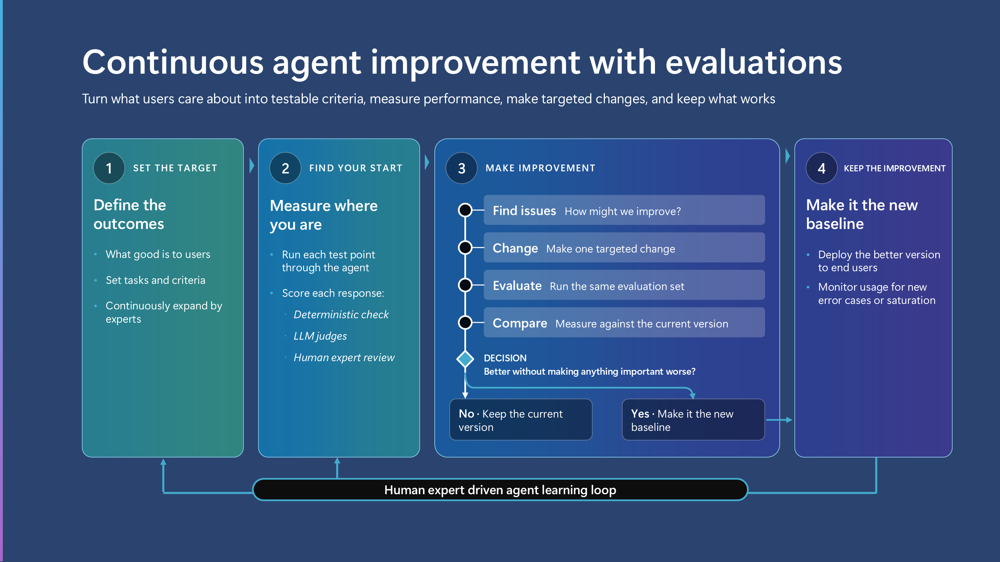

# HVE and HydraFusion: Evaluation, Product Partnership, and Reusable Learning

What began as an engineering question about HVE produced actionable feedback,
a trusted relationship with GitHub's Performance Engineering team, and a
reusable evaluation practice. That relationship did not previously exist in
Frontier Co and is key to turning independent findings into product feedback
and joint customer engagement.

The TLT's Ignite slide, "Continuous agent improvement with evaluations,"
helped us recognize a full-circle story: evaluate HVE, slim it into skills,
build Wharf, learn from its operation, and feed the learning back into the
skills. The method improves systems and expertise, not only agents.

## Why the journey started

Positive HVE customer feedback lacked generated-code evidence.
[DeepSWE](https://deepswe.datacurve.ai/) supplied 113 real-world tasks across
five languages, scored by functional and regression tests. The investigation
expanded into harness comparisons, Auto, and HydraFusion.

Our evaluation unit is **model + harness + skills**. Independent Muse and
Claude Code runs closely reproduced Meta's published aggregate results,
strengthening confidence in the pipeline without constituting paired replication.

## What we built and learned

Pier's scaling limitations led us to use AI and our HVE-derived skills to
develop Wharf, a .NET CLI around Harbor-compatible tasks, Docker, agents, and
verifiers.

- **Do not use the Copilot Auto configuration.** It passed only 37.0% (209/565) DeepSWE attempts.
  In our discussions, GitHub agreed that Auto's performance was inadequate;
  HydraFusion is being developed to improve automatic orchestration.
- **Harness choice matters.** Opus 5 passed 71.2% (322/452) attempts with
  Copilot 1.0.77 versus 64.4% (291/452) with Claude Code, at max effort.
- **Skills need evaluation too.** Without versus with HVE, observed pass rates
  were 71.2% versus 66.4% for Opus 5 and 74.1% versus 68.4% for GPT-5.6 Luna. We delivered feedback recommending
  a slimmer bundle. Our development skills are a very slimmed-down HVE
  subset; further reduction work continues with HVE.
- **Scores miss operational problems.** Repeated HydraFusion tests exposed a
  persistent latency tail despite strong completion. We surfaced that evidence
  to GitHub.
- **Domain knowledge improves the system.** Preparation controls address
  Docker pressure; batching preserves experiments across quota windows.
- **Batching opens an economics research question.** Across seven invocations,
  36 Claude trials were accepted without duplicates; a live Codex quota
  rejection preserved completed work and left the interrupted slot pending.
  Could quota-aware execution improve subscription utilization and lower
  actual cost per useful completion? Continuity is demonstrated; savings
  remain unmeasured.

- **WharfSWE adds an enterprise canary.** We created a separate 14-task C#
  suite from Wharf's development history. DeepSWE lacks .NET and Java; this
  affordable .NET suite makes frequent checks practical. We are working with
  GitHub to include these tests in MSBench.

## Product partnership: a key outcome

Sharing reproducible findings established the GitHub Performance Engineering
relationship. The team now wants to jointly engage customers and is willing
to present at our HVE workshops. It has already delivered a Frontier Co
enablement session on evaluations, introducing
[Vally](https://microsoft.github.io/vally/) for repeatable evaluations,
[TOAST](https://aka.ms/evals/toast) for human side-by-side agent comparisons,
and the [MSBench DeepSWE report](https://msbenchapp.azurewebsites.net/reports/compete?bin=2026-09-28&benchmark=deepswe1-1&metric=avgRate%2CcostP50).

The original success criterion, actionable HVE feedback, is being met.
The partnership extends it into customer engagements and a scalable feedback
path into GitHub Copilot engineering.

## Close the loop

- Rerun the HVE tests on the first HVE release in 2027 to evaluate the updated
  guidance against the baseline.
- Work with the HVE team to incorporate the skills changes we adapted from
  the Ignite slide: **outcome, evidence, hypothesis, evaluation, decision, and
  learning**.

## TLT discussion and ask

1. Help identify customer/partner opportunities for joint engagement with
   GitHub's Performance Engineering team.
2. Is there an opportunity to use Wharf as a working example of the approach
   recommended in the Ignite slide?
3. Is there an opportunity to research quota-aware economics as engineering
   shifts from interactive chat to longer-running agent work?
