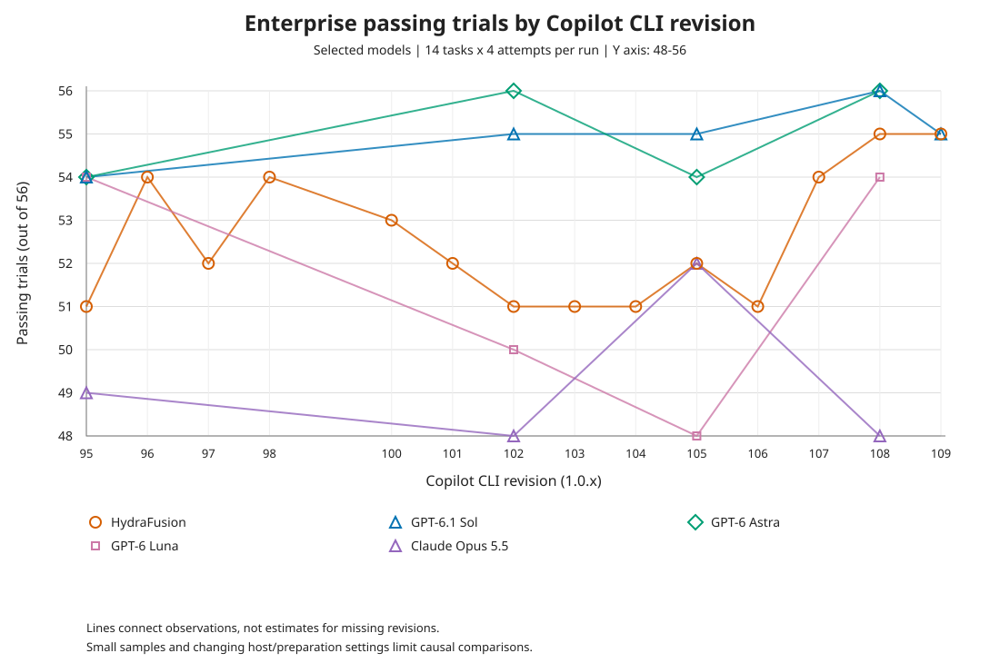
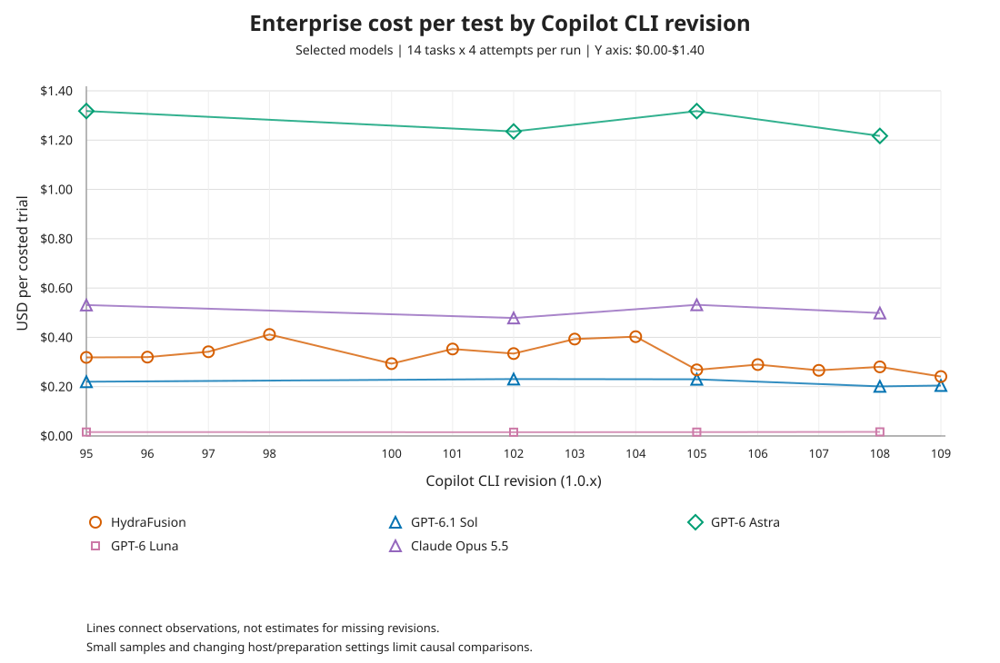
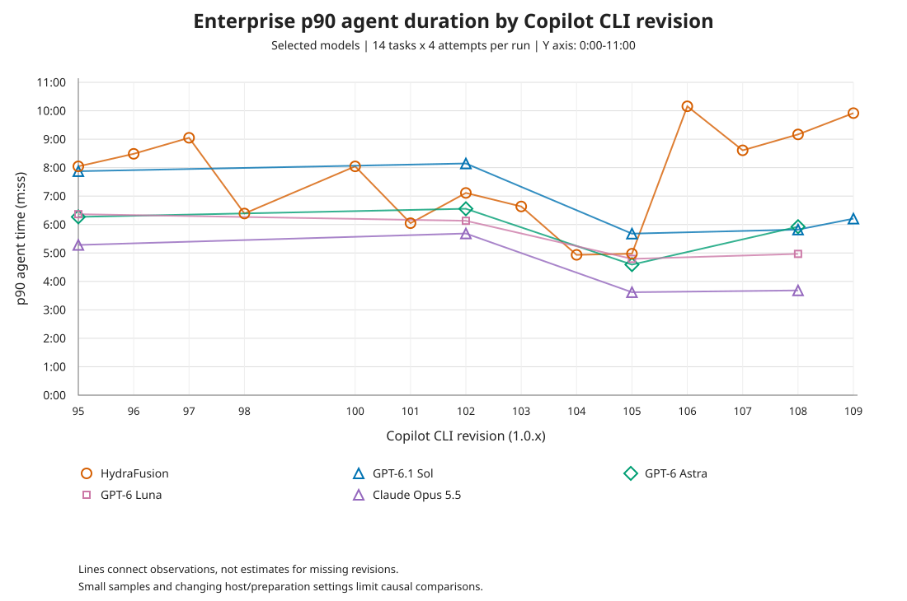

## Passing trials by CLI revision

The graph includes HydraFusion, GPT-6.1 Sol, GPT-6 Astra, GPT-6 Luna, and
Claude Opus 5.5. Each point is one completed 56-trial arm. The X axis starts at
revision 95 and uses only the revision of `1.0.x`. The Y axis shows the number
of passing logical trials out of 56, not a rate or the regression-adjusted
Score, and is zoomed to 48-56 to include every observed count.
Lines connect observed runs; missing revisions are not
additional measurements. Small samples and changes in host/preparation settings
mean these are descriptive comparisons, not isolated CLI-version effects.

## Cost per test by CLI revision

Cost/test is total retained USD cost divided by costed logical trials, not cost
per passing trial. All plotted arms have 56/56 cost coverage; missing costs are
never imputed. The model selection and revision-95 starting point match the
passing-trials graph.

## p90 agent duration by CLI revision

Duration is the 90th percentile of the 56 actual agent-command durations per
arm, calculated using linear interpolation, with Y-axis labels in `m:ss`.
Each trial's duration includes agent time across whole-trial retries but excludes
preparation, evidence copying, and verifier time. All plotted arms have 56/56
duration coverage. Models, revision range, and comparison caveats match the
other graphs.

Regenerate all three graphs from the JSONL exports with
`python3 scripts/plot-enterprise-pass-at-1.py` from the repository root.

## Results

Verified 2026-11-10 from thirty-seven completed runs. Each arm contains 14
tasks and four attempts per task.

Sorted by PASS@1 descending, then P2P errors ascending, then cost ascending.
All runs use default effort and the Copilot CLI.

| Model | Effort | CLI | CLI version | Passes | PASS@1 | P2P errors | Score | Cost/trial | Avg agent time |
|---|---|---|---|---:|---:|---:|---:|---:|---:|
| GPT-6.1 Sol | default | copilot-cli | 1.0.108 | 56 / 56 | 100.00% | 0 | 100.00% | $0.2011 | 243.4 s |
| GPT-6 Astra | default | copilot-cli | 1.0.108 | 56 / 56 | 100.00% | 0 | 100.00% | $1.2170 | 246.4 s |
| GPT-6 Astra | default | copilot-cli | 1.0.102 | 56 / 56 | 100.00% | 0 | 100.00% | $1.2351 | 254.9 s |
| GPT-6.1 Sol | default | copilot-cli | 1.0.105 | 55 / 56 | 98.21% | 0 | 98.21% | $0.2298 | 224.8 s |
| **HydraFusion** | default | copilot-cli | 1.0.109 | 55 / 56 | 98.21% | 0 | 98.21% | $0.2409 | 349.3 s |
| **HydraFusion** | default | copilot-cli | 1.0.108 | 55 / 56 | 98.21% | 0 | 98.21% | $0.2802 | 347.9 s |
| GPT-6.1 Sol | default | copilot-cli | 1.0.109 | 55 / 56 | 98.21% | 1 | 97.96% | $0.2045 | 242.2 s |
| GPT-6.1 Sol | default | copilot-cli | 1.0.102 | 55 / 56 | 98.21% | 1 | 97.96% | $0.2307 | 333.9 s |
| **HydraFusion** | default | copilot-cli | 1.0.107 | 54 / 56 | 96.43% | 0 | 96.43% | $0.2661 | 331.5 s |
| **HydraFusion** | default | copilot-cli | 1.0.98 | 54 / 56 | 96.43% | 0 | 96.43% | $0.4116 | 234.8 s |
| GPT-6 Astra | default | copilot-cli | 1.0.105 | 54 / 56 | 96.43% | 0 | 96.43% | $1.3178 | 174.0 s |
| GPT-6 Astra | default | copilot-cli | 1.0.95 | 54 / 56 | 96.43% | 0 | 96.43% | $1.3180 | 252.5 s |
| GPT-6 Luna | default | copilot-cli | 1.0.108 | 54 / 56 | 96.43% | 1 | 96.18% | $0.0165 | 211.3 s |
| **HydraFusion** | default | copilot-cli | 1.0.96 | 54 / 56 | 96.43% | 1 | 96.18% | $0.3197 | 272.5 s |
| GPT-6 Luna | default | copilot-cli | 1.0.95 | 54 / 56 | 96.43% | 2 | 95.93% | $0.0158 | 257.5 s |
| GPT-6.1 Sol | default | copilot-cli | 1.0.95 | 54 / 56 | 96.43% | 2 | 95.93% | $0.2200 | 283.7 s |
| **HydraFusion** | default | copilot-cli | 1.0.100 | 53 / 56 | 94.64% | 1 | 94.39% | $0.2932 | 272.0 s |
| **HydraFusion** | default | copilot-cli | 1.0.97 | 52 / 56 | 92.86% | 1 | 92.61% | $0.3416 | 316.4 s |
| **HydraFusion** | default | copilot-cli | 1.0.101 | 52 / 56 | 92.86% | 1 | 92.61% | $0.3527 | 218.9 s |
| **HydraFusion** | default | copilot-cli | 1.0.105 | 52 / 56 | 92.86% | 2 | 92.36% | $0.2681 | 188.7 s |
| Claude Opus 5.5 | default | copilot-cli | 1.0.91 | 52 / 56 | 92.86% | 3 | 92.11% | $0.4792 | 180.8 s |
| Claude Opus 5.5 | default | copilot-cli | 1.0.105 | 52 / 56 | 92.86% | 3 | 92.11% | $0.5319 | 147.2 s |
| **HydraFusion** | default | copilot-cli | 1.0.106 | 51 / 56 | 91.07% | 0 | 91.07% | $0.2895 | 378.2 s |
| **HydraFusion** | default | copilot-cli | 1.0.95 | 51 / 56 | 91.07% | 0 | 91.07% | $0.3186 | 302.9 s |
| **HydraFusion** | default | copilot-cli | 1.0.102 | 51 / 56 | 91.07% | 2 | 90.57% | $0.3341 | 266.9 s |
| **HydraFusion** | default | copilot-cli | 1.0.103 | 51 / 56 | 91.07% | 2 | 90.57% | $0.3930 | 229.4 s |
| **HydraFusion** | default | copilot-cli | 1.0.104 | 51 / 56 | 91.07% | 3 | 90.32% | $0.4028 | 196.7 s |
| Gemini 3.8 Flash | default | copilot-cli | 1.0.95 | 50 / 56 | 89.29% | 3 | 88.54% | $0.8911 | 801.5 s |
| GPT-6 Luna | default | copilot-cli | 1.0.102 | 50 / 56 | 89.29% | 4 | 88.29% | $0.0152 | 258.3 s |
| Claude Opus 5.5 | default | copilot-cli | 1.0.95 | 49 / 56 | 87.50% | 5 | 86.25% | $0.5310 | 215.9 s |
| Claude Opus 5 | default | copilot-cli | 1.0.91 | 48 / 56 | 85.71% | 2 | 85.21% | $1.0990 | 230.7 s |
| Claude Opus 5.5 | default | copilot-cli | 1.0.108 | 48 / 56 | 85.71% | 3 | 84.96% | $0.4987 | 148.9 s |
| GPT-6 Luna | default | copilot-cli | 1.0.105 | 48 / 56 | 85.71% | 4 | 84.71% | $0.0156 | 197.1 s |
| Claude Opus 5.5 | default | copilot-cli | 1.0.102 | 48 / 56 | 85.71% | 4 | 84.71% | $0.4785 | 214.5 s |
| MAI Code 1.1 Flash | default | copilot-cli | 1.0.95 | 46 / 56 | 82.14% | 5 | 80.89% | $0.0770 | 275.1 s |
| GPT-5.6 Luna | default | copilot-cli | 1.0.95 | 46 / 56 | 82.14% | 6 | 80.64% | $0.0231 | 190.6 s |
| GPT-5.6 Terra | default | copilot-cli | 1.0.96 | 44 / 56 | 78.57% | 2 | 78.07% | $0.2463 | 141.5 s |

PASS@1 is the trial-level pass rate. P2P errors count trial patches that failed
at least one pre-existing test. Score is `passes / trials - (p2p_errors * 0.0025)`,
displayed as a percentage: each P2P error subtracts 0.25 percentage points.
It is separate from PASS@1 and the Enterprise Score audit metric, is not
clamped at zero, and is null for empty arms.

Average cost divides known cost by cost-bearing
logical trials; all rows in this table have 56/56 cost coverage. Average agent
time uses actual agent-command durations, summed across whole-trial retries,
and excludes preparation, evidence-copy, and verifier time. Equal K makes this
the task-weighted, K-normalized mean as well.

## Latest CLI 1.0.109 comparison

Sources: [HydraFusion](../jobs/copilot-hydrafusion-default-1.0.109/all-1)
and [GPT-6.1 Sol](../jobs/copilot-gpt-6.1-sol-default-1.0.109/all-1).
Both completed runs use identical task IDs/checksums and retained configuration
apart from model: K=4, N=40, P=24, default effort, and unrestricted container
CPUs. Retained image-cache metadata confirms effective CLI 1.0.109 for all
112 trials. These are sequential runs, not replicated model comparisons;
host load and cache conditions are not controlled by matching configuration.

| Metric | HydraFusion | GPT-6.1 Sol |
|---|---:|---:|
| Passes / logical trials | 55 / 56 | 55 / 56 |
| PASS@1 | 98.21% | 98.21% |
| P2P errors | 0 | 1 |
| Score | 98.21% | 97.96% |
| Tasks solved on any retained attempt | 14 / 14 | 14 / 14 |
| Cost coverage | 56 / 56 | 56 / 56 |
| Total known cost | $13.4927 | $11.4526 |
| Cost per costed trial | $0.2409 | $0.2045 |
| Mean agent time | 349.3 s | 242.2 s |
| Median agent time | 256.4 s | 227.1 s |
| Agent p90 | 595.1 s | 372.4 s |
| Agent p95 | 757.7 s | 429.9 s |
| Maximum agent time | 1258.1 s | 517.0 s |
| Agent commands over 10 minutes | 5 / 56 | 0 / 56 |
| Agent commands over 15 minutes | 3 / 56 | 0 / 56 |
| Run elapsed through final cleanup | 24m 23.8s | 13m 37.6s |
| Time to finish first 50 of 56 trials | 12m 55.6s | 8m 19.5s |
| Remaining time for final six trials | 11m 28.2s | 5m 18.1s |

HydraFusion has a substantially heavier observed tail: its median agent time
is only 12.9% higher, but p95 is 76.2% higher and the maximum is 2.43 times
Sol's. Mean agent time is 44.2% higher, cost per costed trial is 17.8% higher,
and run elapsed is 79.0% higher (10m 46.2s longer).

The three longest HydraFusion agent commands are `wharf-verifier` attempt 3
(1258.1 s), `wharf-verifier` attempt 4 (1161.6 s), and `wharf-audit` attempt 2
(941.6 s). All three passed. Sol's longest is `wharf-verifier` attempt 4
(517.0 s). Across four attempts, HydraFusion's mean agent time is 814.1 s
for `wharf-verifier` versus Sol's 425.1 s; `wharf-audit` is 605.7 s versus
275.0 s, and `wharf-smoke` is 577.5 s versus 199.8 s. The tail is therefore
visible in retained agent-command durations, not just preparation or verifier
overhead. In these task names, `wharf-verifier` denotes the task being solved,
not the verification phase.

The reward-zero trials are HydraFusion `wharf-operations` attempt 1
(2/3 functional tests, 1/1 regression tests) and Sol `wharf-smoke` attempt 4
(0/3 functional tests, 0/1 regression tests). Neither run has whole-trial
retries, verifier retries, or exception categories; all trials remain in the
denominator.

Timing percentiles use linear interpolation over the 56 actual agent-command
durations. Run elapsed spans the retained run-start timestamp to final cleanup;
the final-six interval starts when the 50th cleanup completes and includes
any remaining scheduling, preparation, agent execution, verification, and
cleanup. It is not a pure agent-time measure or an average trial duration.

## Data coverage

* Exported arms: 37
* Exported logical trials: 2072
* Unique tasks per arm: 14
* Attempts per task: 4
* Functional and regression measurements: 2072 / 2072 trials
* Agent and trial duration measurements: 2072 / 2072 trials
* Trials with an exception category: 0

Only completed `all-1` runs are included.
Infrastructure and verifier retries are not additional logical trials.
