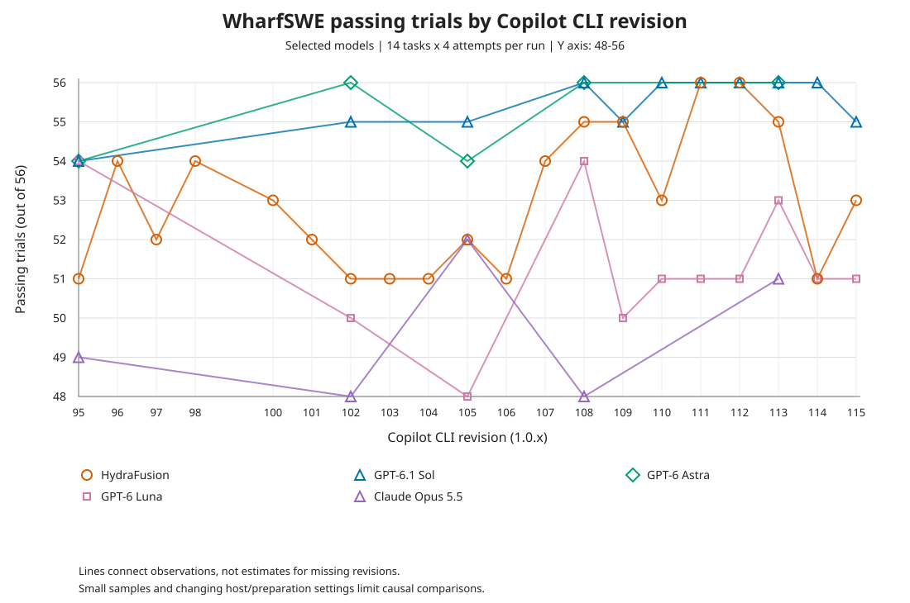
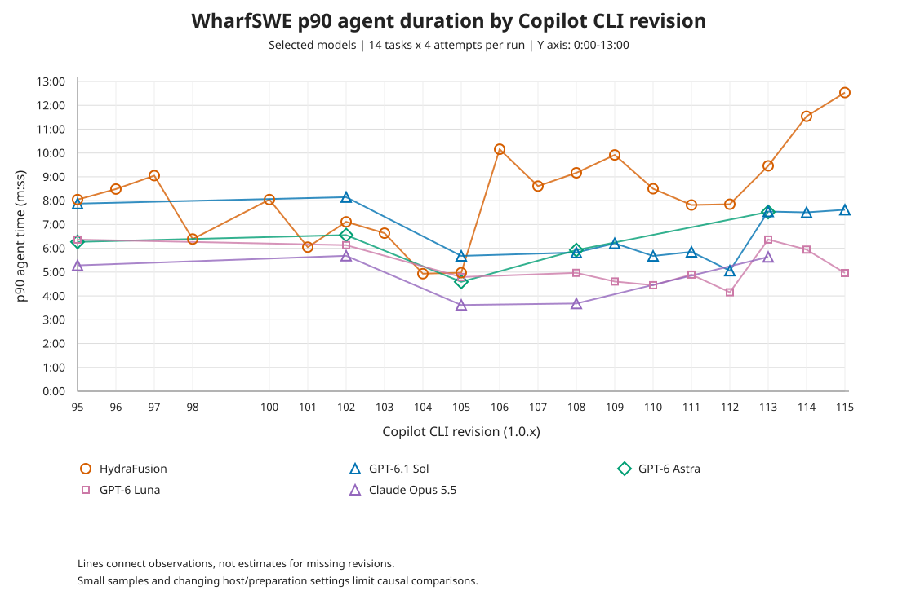

# WharfSWE

WharfSWE is a 14-task C# software-engineering benchmark built from Wharf's own
development history. The Wharf CLI runs this suite separately from DeepSWE.
At K=4, each arm contains 56 logical trials.

## Passing trials by CLI revision

The graph includes HydraFusion, GPT-6.1 Sol, GPT-6 Astra, GPT-6 Luna, and
Claude Opus 5.5. Each point is one completed 56-trial arm. The X axis starts at
revision 95 and uses only the revision of `1.0.x`. The Y axis shows the number
of passing logical trials out of 56, not a rate or the regression-adjusted
Score, and is zoomed to 48-56 to include every observed count.
Lines connect observed runs; missing revisions are not
additional measurements. Small samples and changes in host/preparation settings
mean these are descriptive comparisons, not isolated CLI-version effects.
Seven historical revision-95 arms retain different task checksums from the
recent runs, so the full history is not a checksum-matched experiment.

## Cost per test by CLI revision

Cost/test is total retained USD cost divided by costed logical trials, not cost
per passing trial. All plotted arms have 56/56 cost coverage; missing costs are
never imputed. The model selection and revision-95 starting point match the
passing-trials graph.

## p90 agent duration by CLI revision

Duration is the 90th percentile of the 56 actual agent-command durations per
arm, calculated using linear interpolation, with Y-axis labels in `m:ss`.
Each trial's duration includes agent time across whole-trial retries but excludes
preparation, evidence copying, and verifier time. All plotted arms have 56/56
duration coverage. Models, revision range, and comparison caveats match the
other graphs.

Regenerate all three graphs in `wharf-swe/docs/` from the JSONL exports in
`wharf-swe/data/` with `python3 scripts/plot-wharf-swe-pass-at-1.py` from the
repository root. Keep this README aligned with `data/manifest.json`.

## Latest completed runs

The latest Copilot runs use CLI 1.0.114; the completed Codex runs use 0.169.0.
All four arms use the same 14 task IDs/checksums, K=4/N=56, and default effort.
Copilot uses P=16, while Codex uses P=12. These compare model plus harness
configurations, not isolated model capability or controlled CLI-version effects.
The revision graphs above include only Copilot arms, through revision 114.

| Model | CLI | CLI version | Passes | PASS@1 | P2P errors | Score | Cost/trial | Avg agent time |
|---|---|---|---:|---:|---:|---:|---:|---:|
| GPT-6.1 Sol | copilot-cli | 1.0.114 | 56 / 56 | 100.00% | 0 | 100.00% | $0.2064 | 335.6 s |
| HydraFusion | copilot-cli | 1.0.114 | 51 / 56 | 91.07% | 0 | 91.07% | $0.2729 | 419.5 s |
| GPT-6 Luna | copilot-cli | 1.0.114 | 51 / 56 | 91.07% | 2 | 90.57% | $0.0162 | 265.2 s |
| GPT-6 Luna | codex | 0.169.0 | 40 / 56 | 71.43% | 11 | 68.68% | unknown | 95.8 s |

Sources: [Copilot Sol](jobs/copilot-gpt-6.1-sol-default-1.0.114/all-1),
[Copilot HydraFusion](jobs/copilot-hydrafusion-default-1.0.114/all-1),
[Copilot Luna](jobs/copilot-gpt-6-luna-default-1.0.114/all-1), and
[Codex Luna](jobs/codex-gpt-6-luna-default-0.169.0/all-1).

All 224 logical trials in these four completed arms are included.
Codex Luna records five logical trials with an
agent-execution exception and one whole-trial retry; its duration includes
both agent executions for that trial. Nonzero exits can shorten agent time,
so shorter durations are not necessarily efficiency gains.

Copilot has 56/56 cost coverage per arm; Codex Luna has 0/56 retained
billed-cost coverage. API-equivalent estimates are not inserted into
`cost_usd` or compared as actual ChatGPT subscription charges.

### Pending recovery fixtures

The [Claude Code Opus run](jobs/claude-claude-opus-5-5-default-2.1.326/all-1)
has 47 terminal slots (46 passed, one failed) and nine pending of 56.
The [Codex Sol run](jobs/codex-gpt-6.1-sol-default-0.169.0/all-1)
has 42 terminal slots (40 passed, two failed) and 14 pending of 56.
Quota-interrupted payloads were permanently deleted after a durable
[audit record](../.github/tracking/2026-11-18-quota-recovery-fixtures-audit.json)
so both runs can exercise pristine batch recovery without rerunning other slots.
The run plans and original append-only logs are unchanged.

Neither run is a completed comparison arm. Sol's previous 56-row export is
retained only as a
[superseded analytics snapshot](../.github/tracking/superseded-analytics/codex-gpt-6.1-sol-default-0.169.0-before-quota-reopen.jsonl),
outside active discovery. After recovery, re-export the completed 56-slot run
and rebuild the manifest. Pending slots never reduce the denominator to 42
or 47. The `run -b` feature is specified but not implemented yet; no recovery
agents were launched during fixture preparation.

## Historical CLI 1.0.113 comparison

Sources: [HydraFusion](jobs/copilot-hydrafusion-default-1.0.113/all-1),
[GPT-6.1 Sol](jobs/copilot-gpt-6.1-sol-default-1.0.113/all-1),
[GPT-6 Astra](jobs/copilot-gpt-6-astra-default-1.0.113/all-1),
[GPT-6 Luna](jobs/copilot-gpt-6-luna-default-1.0.113/all-1), and
[Claude Opus 5.5](jobs/copilot-claude-opus-5.5-default-1.0.113/all-1).
All five completed Copilot runs use the same 14 task IDs/checksums,
K=4, N=56, P=12, CLI 1.0.113, and default effort. These are descriptive
observations, not replicated model comparisons or controlled CLI-version tests.

| Model | Passes | PASS@1 | P2P errors | Score | Cost/trial | Avg agent time |
|---|---:|---:|---:|---:|---:|---:|
| GPT-6.1 Sol | 56 / 56 | 100.00% | 0 | 100.00% | $0.2082 | 330.5 s |
| GPT-6 Astra | 56 / 56 | 100.00% | 0 | 100.00% | $1.1352 | 296.5 s |
| HydraFusion | 55 / 56 | 98.21% | 0 | 98.21% | $0.2531 | 388.5 s |
| GPT-6 Luna | 53 / 56 | 94.64% | 1 | 94.39% | $0.0157 | 274.6 s |
| Claude Opus 5.5 | 51 / 56 | 91.07% | 2 | 90.57% | $0.4935 | 206.6 s |

All five arms have 56/56 cost and agent-duration coverage, all 14 tasks solved
on at least one attempt, and no whole-trial retries, verifier retries, or
exception categories. All 280 logical trials remain included. Sol and Astra
pass every trial without measured regressions; Luna has the lowest cost per
costed trial. Claude Opus 5.5 here runs through Copilot, not Claude Code.
The separate Claude Code run awaiting usage-limit recovery is not exported.

## Data coverage

* Exported arms: 56
* Exported logical trials: 3136
* Unique tasks per arm: 14
* Attempts per task: 4
* Functional and regression measurements: 3136 / 3136 trials
* Agent and trial duration measurements: 3136 / 3136 trials
* Cost evidence: 3080 / 3136 trials (98.21%)
* Trials with an exception category: 5

Only completed `all-1` runs are included.
Infrastructure and verifier retries are not additional logical trials.

## Results

Verified 2026-11-18 from fifty-six completed runs. Each arm contains 14
tasks and four attempts per task.

Sorted by PASS@1 descending, then P2P errors ascending, then cost ascending
(unknown costs last within ties). All runs use default effort; CLI identity
and version are explicit.

| Model | Effort | CLI | CLI version | Passes | PASS@1 | P2P errors | Score | Cost/trial | Avg agent time |
|---|---|---|---|---:|---:|---:|---:|---:|---:|
| GPT-6.1 Sol | default | copilot-cli | 1.0.112 | 56 / 56 | 100.00% | 0 | 100.00% | $0.1872 | 191.5 s |
| GPT-6.1 Sol | default | copilot-cli | 1.0.110 | 56 / 56 | 100.00% | 0 | 100.00% | $0.1934 | 199.3 s |
| GPT-6.1 Sol | default | copilot-cli | 1.0.108 | 56 / 56 | 100.00% | 0 | 100.00% | $0.2011 | 243.4 s |
| GPT-6.1 Sol | default | copilot-cli | 1.0.111 | 56 / 56 | 100.00% | 0 | 100.00% | $0.2020 | 196.6 s |
| GPT-6.1 Sol | default | copilot-cli | 1.0.114 | 56 / 56 | 100.00% | 0 | 100.00% | $0.2064 | 335.6 s |
| GPT-6.1 Sol | default | copilot-cli | 1.0.113 | 56 / 56 | 100.00% | 0 | 100.00% | $0.2082 | 330.5 s |
| **HydraFusion** | default | copilot-cli | 1.0.111 | 56 / 56 | 100.00% | 0 | 100.00% | $0.2247 | 303.1 s |
| **HydraFusion** | default | copilot-cli | 1.0.112 | 56 / 56 | 100.00% | 0 | 100.00% | $0.2566 | 299.4 s |
| GPT-6 Astra | default | copilot-cli | 1.0.113 | 56 / 56 | 100.00% | 0 | 100.00% | $1.1352 | 296.5 s |
| GPT-6 Astra | default | copilot-cli | 1.0.108 | 56 / 56 | 100.00% | 0 | 100.00% | $1.2170 | 246.4 s |
| GPT-6 Astra | default | copilot-cli | 1.0.102 | 56 / 56 | 100.00% | 0 | 100.00% | $1.2351 | 254.9 s |
| GPT-6.1 Sol | default | copilot-cli | 1.0.105 | 55 / 56 | 98.21% | 0 | 98.21% | $0.2298 | 224.8 s |
| **HydraFusion** | default | copilot-cli | 1.0.109 | 55 / 56 | 98.21% | 0 | 98.21% | $0.2409 | 349.3 s |
| **HydraFusion** | default | copilot-cli | 1.0.113 | 55 / 56 | 98.21% | 0 | 98.21% | $0.2531 | 388.5 s |
| **HydraFusion** | default | copilot-cli | 1.0.108 | 55 / 56 | 98.21% | 0 | 98.21% | $0.2802 | 347.9 s |
| GPT-6.1 Sol | default | copilot-cli | 1.0.109 | 55 / 56 | 98.21% | 1 | 97.96% | $0.2045 | 242.2 s |
| GPT-6.1 Sol | default | copilot-cli | 1.0.102 | 55 / 56 | 98.21% | 1 | 97.96% | $0.2307 | 333.9 s |
| **HydraFusion** | default | copilot-cli | 1.0.107 | 54 / 56 | 96.43% | 0 | 96.43% | $0.2661 | 331.5 s |
| **HydraFusion** | default | copilot-cli | 1.0.98 | 54 / 56 | 96.43% | 0 | 96.43% | $0.4116 | 234.8 s |
| GPT-6 Astra | default | copilot-cli | 1.0.105 | 54 / 56 | 96.43% | 0 | 96.43% | $1.3178 | 174.0 s |
| GPT-6 Astra | default | copilot-cli | 1.0.95 | 54 / 56 | 96.43% | 0 | 96.43% | $1.3180 | 252.5 s |
| GPT-6 Luna | default | copilot-cli | 1.0.108 | 54 / 56 | 96.43% | 1 | 96.18% | $0.0165 | 211.3 s |
| **HydraFusion** | default | copilot-cli | 1.0.96 | 54 / 56 | 96.43% | 1 | 96.18% | $0.3197 | 272.5 s |
| GPT-6 Luna | default | copilot-cli | 1.0.95 | 54 / 56 | 96.43% | 2 | 95.93% | $0.0158 | 257.5 s |
| GPT-6.1 Sol | default | copilot-cli | 1.0.95 | 54 / 56 | 96.43% | 2 | 95.93% | $0.2200 | 283.7 s |
| **HydraFusion** | default | copilot-cli | 1.0.110 | 53 / 56 | 94.64% | 0 | 94.64% | $0.2324 | 296.0 s |
| GPT-6 Luna | default | copilot-cli | 1.0.113 | 53 / 56 | 94.64% | 1 | 94.39% | $0.0157 | 274.6 s |
| **HydraFusion** | default | copilot-cli | 1.0.100 | 53 / 56 | 94.64% | 1 | 94.39% | $0.2932 | 272.0 s |
| **HydraFusion** | default | copilot-cli | 1.0.97 | 52 / 56 | 92.86% | 1 | 92.61% | $0.3416 | 316.4 s |
| **HydraFusion** | default | copilot-cli | 1.0.101 | 52 / 56 | 92.86% | 1 | 92.61% | $0.3527 | 218.9 s |
| **HydraFusion** | default | copilot-cli | 1.0.105 | 52 / 56 | 92.86% | 2 | 92.36% | $0.2681 | 188.7 s |
| Claude Opus 5.5 | default | copilot-cli | 1.0.91 | 52 / 56 | 92.86% | 3 | 92.11% | $0.4792 | 180.8 s |
| Claude Opus 5.5 | default | copilot-cli | 1.0.105 | 52 / 56 | 92.86% | 3 | 92.11% | $0.5319 | 147.2 s |
| **HydraFusion** | default | copilot-cli | 1.0.114 | 51 / 56 | 91.07% | 0 | 91.07% | $0.2729 | 419.5 s |
| **HydraFusion** | default | copilot-cli | 1.0.106 | 51 / 56 | 91.07% | 0 | 91.07% | $0.2895 | 378.2 s |
| **HydraFusion** | default | copilot-cli | 1.0.95 | 51 / 56 | 91.07% | 0 | 91.07% | $0.3186 | 302.9 s |
| GPT-6 Luna | default | copilot-cli | 1.0.111 | 51 / 56 | 91.07% | 2 | 90.57% | $0.0137 | 200.0 s |
| GPT-6 Luna | default | copilot-cli | 1.0.114 | 51 / 56 | 91.07% | 2 | 90.57% | $0.0162 | 265.2 s |
| **HydraFusion** | default | copilot-cli | 1.0.102 | 51 / 56 | 91.07% | 2 | 90.57% | $0.3341 | 266.9 s |
| **HydraFusion** | default | copilot-cli | 1.0.103 | 51 / 56 | 91.07% | 2 | 90.57% | $0.3930 | 229.4 s |
| Claude Opus 5.5 | default | copilot-cli | 1.0.113 | 51 / 56 | 91.07% | 2 | 90.57% | $0.4935 | 206.6 s |
| GPT-6 Luna | default | copilot-cli | 1.0.112 | 51 / 56 | 91.07% | 3 | 90.32% | $0.0135 | 170.9 s |
| GPT-6 Luna | default | copilot-cli | 1.0.110 | 51 / 56 | 91.07% | 3 | 90.32% | $0.0141 | 183.0 s |
| **HydraFusion** | default | copilot-cli | 1.0.104 | 51 / 56 | 91.07% | 3 | 90.32% | $0.4028 | 196.7 s |
| GPT-6 Luna | default | copilot-cli | 1.0.109 | 50 / 56 | 89.29% | 2 | 88.79% | $0.0140 | 177.1 s |
| Gemini 3.8 Flash | default | copilot-cli | 1.0.95 | 50 / 56 | 89.29% | 3 | 88.54% | $0.8911 | 801.5 s |
| GPT-6 Luna | default | copilot-cli | 1.0.102 | 50 / 56 | 89.29% | 4 | 88.29% | $0.0152 | 258.3 s |
| Claude Opus 5.5 | default | copilot-cli | 1.0.95 | 49 / 56 | 87.50% | 5 | 86.25% | $0.5310 | 215.9 s |
| Claude Opus 5 | default | copilot-cli | 1.0.91 | 48 / 56 | 85.71% | 2 | 85.21% | $1.0990 | 230.7 s |
| Claude Opus 5.5 | default | copilot-cli | 1.0.108 | 48 / 56 | 85.71% | 3 | 84.96% | $0.4987 | 148.9 s |
| GPT-6 Luna | default | copilot-cli | 1.0.105 | 48 / 56 | 85.71% | 4 | 84.71% | $0.0156 | 197.1 s |
| Claude Opus 5.5 | default | copilot-cli | 1.0.102 | 48 / 56 | 85.71% | 4 | 84.71% | $0.4785 | 214.5 s |
| MAI Code 1.1 Flash | default | copilot-cli | 1.0.95 | 46 / 56 | 82.14% | 5 | 80.89% | $0.0770 | 275.1 s |
| GPT-5.6 Luna | default | copilot-cli | 1.0.95 | 46 / 56 | 82.14% | 6 | 80.64% | $0.0231 | 190.6 s |
| GPT-5.6 Terra | default | copilot-cli | 1.0.96 | 44 / 56 | 78.57% | 2 | 78.07% | $0.2463 | 141.5 s |
| GPT-6 Luna | default | codex | 0.169.0 | 40 / 56 | 71.43% | 11 | 68.68% | unknown | 95.8 s |

PASS@1 is the trial-level pass rate. P2P errors count trial patches that failed
at least one pre-existing test. Score is `passes / trials - (p2p_errors * 0.0025)`,
displayed as a percentage: each P2P error subtracts 0.25 percentage points.
It is separate from PASS@1 and the Enterprise Score audit metric, is not
clamped at zero, and is null for empty arms.

Cost/trial divides known cost by cost-bearing logical trials.
Copilot rows have 56/56 cost coverage; Codex rows have 0/56 and show unknown.
Average agent
time uses actual agent-command durations, summed across whole-trial retries,
and excludes preparation, evidence-copy, and verifier time. Equal K makes this
the task-weighted, K-normalized mean as well.
