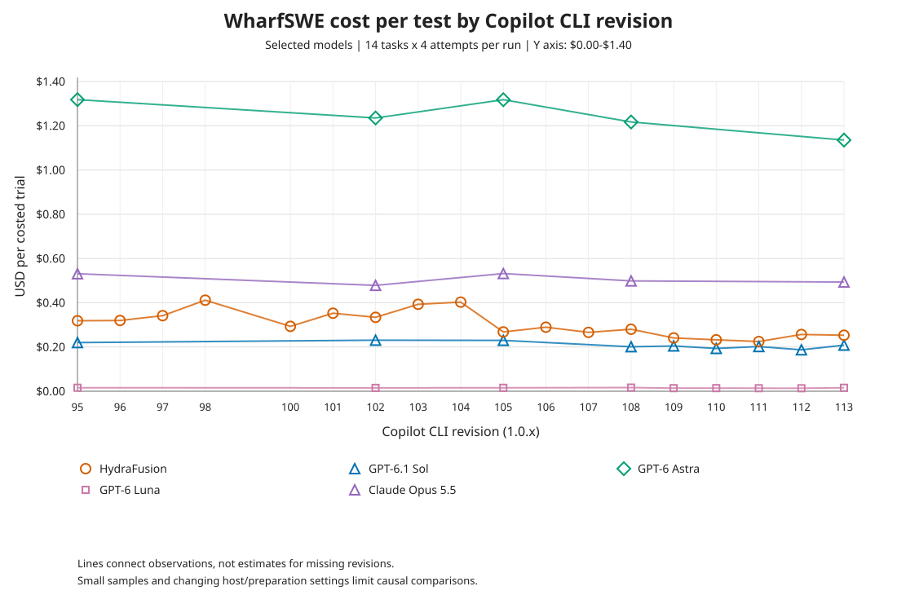

# WharfSWE

WharfSWE is a 14-task C# software-engineering benchmark built from Wharf's
development history. At K=4, each job contains 56 logical trials.

## Passing trials by CLI revision

## Cost per test by CLI revision

## p90 agent duration by CLI revision

Duration is the 90th percentile of the 56 actual agent-command durations per
arm, calculated using linear interpolation, with Y-axis labels in `m:ss`.
Each trial's duration includes agent time across whole-trial retries but excludes
preparation, evidence copying, and verifier time.

Regenerate all three graphs in `wharf-swe/docs/` from the JSONL exports in
`wharf-swe/data/` with `python3 scripts/plot-wharf-swe-pass-at-1.py` from the
repository root. Keep this README aligned with `data/manifest.json`.

## Results

Sorted by PASS@1 descending, then P2P errors, then cost. All runs use default effort.

| Model | Effort | CLI | CLI version | Passes | PASS@1 | P2P errors | Score | Cost/trial | Avg agent time |
|---|---|---|---|---:|---:|---:|---:|---:|---:|
| GPT-6.1 Sol | default | copilot-cli | 1.0.112 | 56 / 56 | 100.00% | 0 | 100.00% | $0.1872 | 191.5 s |
| GPT-6.1 Sol | default | copilot-cli | 1.0.116 | 56 / 56 | 100.00% | 0 | 100.00% | $0.1901 | 306.2 s |
| GPT-6.1 Sol | default | copilot-cli | 1.0.110 | 56 / 56 | 100.00% | 0 | 100.00% | $0.1934 | 199.3 s |
| GPT-6.1 Sol | default | copilot-cli | 1.0.108 | 56 / 56 | 100.00% | 0 | 100.00% | $0.2011 | 243.4 s |
| GPT-6.1 Sol | default | copilot-cli | 1.0.111 | 56 / 56 | 100.00% | 0 | 100.00% | $0.2020 | 196.6 s |
| GPT-6.1 Sol | default | copilot-cli | 1.0.114 | 56 / 56 | 100.00% | 0 | 100.00% | $0.2064 | 335.6 s |
| GPT-6.1 Sol | default | copilot-cli | 1.0.113 | 56 / 56 | 100.00% | 0 | 100.00% | $0.2082 | 330.5 s |
| **HydraFusion** | default | copilot-cli | 1.0.111 | 56 / 56 | 100.00% | 0 | 100.00% | $0.2247 | 303.1 s |
| **HydraFusion** | default | copilot-cli | 1.0.112 | 56 / 56 | 100.00% | 0 | 100.00% | $0.2566 | 299.4 s |
| GPT-6 Astra | default | copilot-cli | 1.0.113 | 56 / 56 | 100.00% | 0 | 100.00% | $1.1352 | 296.5 s |
| GPT-6 Astra | default | copilot-cli | 1.0.108 | 56 / 56 | 100.00% | 0 | 100.00% | $1.2170 | 246.4 s |
| GPT-6 Astra | default | copilot-cli | 1.0.102 | 56 / 56 | 100.00% | 0 | 100.00% | $1.2351 | 254.9 s |
| GPT-6.1 Sol | default | copilot-cli | 1.0.115 | 55 / 56 | 98.21% | 0 | 98.21% | $0.1958 | 313.6 s |
| GPT-6.1 Sol | default | copilot-cli | 1.0.105 | 55 / 56 | 98.21% | 0 | 98.21% | $0.2298 | 224.8 s |
| **HydraFusion** | default | copilot-cli | 1.0.109 | 55 / 56 | 98.21% | 0 | 98.21% | $0.2409 | 349.3 s |
| **HydraFusion** | default | copilot-cli | 1.0.113 | 55 / 56 | 98.21% | 0 | 98.21% | $0.2531 | 388.5 s |
| **HydraFusion** | default | copilot-cli | 1.0.108 | 55 / 56 | 98.21% | 0 | 98.21% | $0.2802 | 347.9 s |
| Claude Opus 5.5 | default | claude | 2.1.326 | 55 / 56 | 98.21% | 0 | 98.21% | $0.3582 | 124.6 s |
| GPT-6 Astra | default | copilot-cli | 1.0.116 | 55 / 56 | 98.21% | 0 | 98.21% | $1.1409 | 295.6 s |
| GPT-6 Astra | default | codex | 0.169.0 | 55 / 56 | 98.21% | 0 | 98.21% | unknown | 160.0 s |
| GPT-6.1 Sol | default | copilot-cli | 1.0.109 | 55 / 56 | 98.21% | 1 | 97.96% | $0.2045 | 242.2 s |
| GPT-6.1 Sol | default | copilot-cli | 1.0.102 | 55 / 56 | 98.21% | 1 | 97.96% | $0.2307 | 333.9 s |
| **HydraFusion** | default | copilot-cli | 1.0.107 | 54 / 56 | 96.43% | 0 | 96.43% | $0.2661 | 331.5 s |
| **HydraFusion** | default | copilot-cli | 1.0.98 | 54 / 56 | 96.43% | 0 | 96.43% | $0.4116 | 234.8 s |
| GPT-6 Astra | default | copilot-cli | 1.0.105 | 54 / 56 | 96.43% | 0 | 96.43% | $1.3178 | 174.0 s |
| GPT-6 Astra | default | copilot-cli | 1.0.95 | 54 / 56 | 96.43% | 0 | 96.43% | $1.3180 | 252.5 s |
| GPT-6 Luna | default | copilot-cli | 1.0.108 | 54 / 56 | 96.43% | 1 | 96.18% | $0.0165 | 211.3 s |
| **HydraFusion** | default | copilot-cli | 1.0.96 | 54 / 56 | 96.43% | 1 | 96.18% | $0.3197 | 272.5 s |
| GPT-6.1 Sol | default | codex | 0.169.0 | 54 / 56 | 96.43% | 1 | 96.18% | unknown | 165.5 s |
| GPT-6 Luna | default | copilot-cli | 1.0.95 | 54 / 56 | 96.43% | 2 | 95.93% | $0.0158 | 257.5 s |
| GPT-6.1 Sol | default | copilot-cli | 1.0.95 | 54 / 56 | 96.43% | 2 | 95.93% | $0.2200 | 283.7 s |
| **HydraFusion** | default | copilot-cli | 1.0.110 | 53 / 56 | 94.64% | 0 | 94.64% | $0.2324 | 296.0 s |
| **HydraFusion** | default | copilot-cli | 1.0.116 | 53 / 56 | 94.64% | 0 | 94.64% | $0.2594 | 391.2 s |
| **HydraFusion** | default | copilot-cli | 1.0.115 | 53 / 56 | 94.64% | 0 | 94.64% | $0.3070 | 458.1 s |
| GPT-6 Luna | default | copilot-cli | 1.0.113 | 53 / 56 | 94.64% | 1 | 94.39% | $0.0157 | 274.6 s |
| **HydraFusion** | default | copilot-cli | 1.0.100 | 53 / 56 | 94.64% | 1 | 94.39% | $0.2932 | 272.0 s |
| **HydraFusion** | default | copilot-cli | 1.0.97 | 52 / 56 | 92.86% | 1 | 92.61% | $0.3416 | 316.4 s |
| **HydraFusion** | default | copilot-cli | 1.0.101 | 52 / 56 | 92.86% | 1 | 92.61% | $0.3527 | 218.9 s |
| **HydraFusion** | default | copilot-cli | 1.0.105 | 52 / 56 | 92.86% | 2 | 92.36% | $0.2681 | 188.7 s |
| Claude Opus 5.5 | default | copilot-cli | 1.0.91 | 52 / 56 | 92.86% | 3 | 92.11% | $0.4792 | 180.8 s |
| Claude Opus 5.5 | default | copilot-cli | 1.0.105 | 52 / 56 | 92.86% | 3 | 92.11% | $0.5319 | 147.2 s |
| **HydraFusion** | default | copilot-cli | 1.0.114 | 51 / 56 | 91.07% | 0 | 91.07% | $0.2729 | 419.5 s |
| **HydraFusion** | default | copilot-cli | 1.0.106 | 51 / 56 | 91.07% | 0 | 91.07% | $0.2895 | 378.2 s |
| **HydraFusion** | default | copilot-cli | 1.0.95 | 51 / 56 | 91.07% | 0 | 91.07% | $0.3186 | 302.9 s |
| GPT-6 Luna | default | copilot-cli | 1.0.111 | 51 / 56 | 91.07% | 2 | 90.57% | $0.0137 | 200.0 s |
| GPT-6 Luna | default | copilot-cli | 1.0.114 | 51 / 56 | 91.07% | 2 | 90.57% | $0.0162 | 265.2 s |
| **HydraFusion** | default | copilot-cli | 1.0.102 | 51 / 56 | 91.07% | 2 | 90.57% | $0.3341 | 266.9 s |
| **HydraFusion** | default | copilot-cli | 1.0.103 | 51 / 56 | 91.07% | 2 | 90.57% | $0.3930 | 229.4 s |
| Claude Opus 5.5 | default | copilot-cli | 1.0.113 | 51 / 56 | 91.07% | 2 | 90.57% | $0.4935 | 206.6 s |
| GPT-6 Luna | default | copilot-cli | 1.0.112 | 51 / 56 | 91.07% | 3 | 90.32% | $0.0135 | 170.9 s |
| GPT-6 Luna | default | copilot-cli | 1.0.110 | 51 / 56 | 91.07% | 3 | 90.32% | $0.0141 | 183.0 s |
| GPT-6 Luna | default | copilot-cli | 1.0.115 | 51 / 56 | 91.07% | 3 | 90.32% | $0.0148 | 209.2 s |
| **HydraFusion** | default | copilot-cli | 1.0.104 | 51 / 56 | 91.07% | 3 | 90.32% | $0.4028 | 196.7 s |
| GPT-6 Luna | default | copilot-cli | 1.0.109 | 50 / 56 | 89.29% | 2 | 88.79% | $0.0140 | 177.1 s |
| Claude Opus 5.5 | default | copilot-cli | 1.0.116 | 50 / 56 | 89.29% | 2 | 88.79% | $0.5240 | 209.4 s |
| Gemini 3.8 Flash | default | copilot-cli | 1.0.95 | 50 / 56 | 89.29% | 3 | 88.54% | $0.8911 | 801.5 s |
| GPT-6 Luna | default | copilot-cli | 1.0.102 | 50 / 56 | 89.29% | 4 | 88.29% | $0.0152 | 258.3 s |
| Claude Opus 5.5 | default | copilot-cli | 1.0.95 | 49 / 56 | 87.50% | 5 | 86.25% | $0.5310 | 215.9 s |
| Claude Opus 5 | default | copilot-cli | 1.0.91 | 48 / 56 | 85.71% | 2 | 85.21% | $1.0990 | 230.7 s |
| Claude Opus 5.5 | default | copilot-cli | 1.0.108 | 48 / 56 | 85.71% | 3 | 84.96% | $0.4987 | 148.9 s |
| GPT-6 Luna | default | copilot-cli | 1.0.116 | 48 / 56 | 85.71% | 4 | 84.71% | $0.0150 | 227.8 s |
| GPT-6 Luna | default | copilot-cli | 1.0.105 | 48 / 56 | 85.71% | 4 | 84.71% | $0.0156 | 197.1 s |
| Claude Opus 5.5 | default | copilot-cli | 1.0.102 | 48 / 56 | 85.71% | 4 | 84.71% | $0.4785 | 214.5 s |
| MAI Code 1.1 Flash | default | copilot-cli | 1.0.95 | 46 / 56 | 82.14% | 5 | 80.89% | $0.0770 | 275.1 s |
| GPT-5.6 Luna | default | copilot-cli | 1.0.95 | 46 / 56 | 82.14% | 6 | 80.64% | $0.0231 | 190.6 s |
| GPT-5.6 Terra | default | copilot-cli | 1.0.96 | 44 / 56 | 78.57% | 2 | 78.07% | $0.2463 | 141.5 s |
| GPT-6 Luna | default | codex | 0.169.0 | 40 / 56 | 71.43% | 11 | 68.68% | unknown | 95.8 s |
